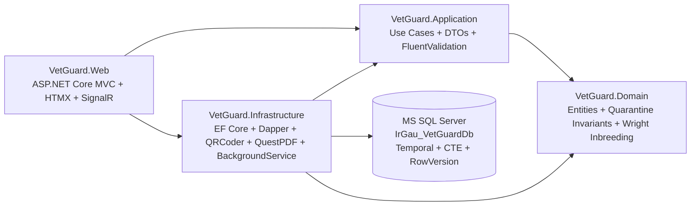

# 🛡️ VetGuard — Система ветеринарных QR-паспортов поголовья, «Карантинного замка» и племенного подбора пар

> **Портфолио-проект уровня Middle+ (.NET 10 / ASP.NET Core MVC / EF Core + Dapper / MS SQL Server / HTMX + SignalR / QRCoder + QuestPDF)**  
> Разработано для задач **ветеринарного факультета ФГБОУ ВО Иркутский ГАУ им. А.А. Ежевского**, учебно-опытных и племенных фермерских хозяйств.

| Параметр | Значение |
|---|---|
| **Расположение** | `C:\Portfolio\VetGuard` |
| **Решение** | `VetGuard.sln` |
| **База данных (MS SQL Server)** | `IrGau_VetGuardDb` (`Cyrillic_General_100_CI_AS`) |
| **Веб-порт** | `http://localhost:5104` |
| **Репозиторий** | `https://github.com/egorindza/VetGuard` |

---

## 🏗️ Архитектура решения (Clean Architecture)



- **`VetGuard.Domain`** — богатое доменное ядро без внешних зависимостей: учетные карточки КРС (`Animal`), справочник биопрепаратов и антибиотиков (`VetDrug`), журнал ЛПМ (`TreatmentRecord`), товарные партии (`ProductBatch`), строгие доменные инварианты «Карантинного замка» (`QuarantineLockDomainException`) и чистый математический алгоритм расчета коэффициента инбридинга Сьюэлла Райта ($F_X$) со шкалой Шапоружа.
- **`VetGuard.Application`** — контракты прикладных сервисов, модели команд/запросов и строгая входная валидация через `FluentValidation`.
- **`VetGuard.Infrastructure`** — `VetGuardDbContext` (EF Core 10), высокопроизводительные рекурсивные T-SQL запросы через `Dapper`, генерация векторных и растровых QR-паспортов (`QRCoder`), генерация 4 видов официальных PDF-документов (`QuestPDF`), фоновый планировщик (`EpizooticPlannerHostedService : BackgroundService`) и демонстрационный `VetGuardDbSeeder` учхоза ИрГАУ.
- **`VetGuard.Web`** — адаптивный медицинско-аграрный интерфейс со светлой и темной темой, реактивными частичными обновлениями на **HTMX**, живыми оповещениями **SignalR** (`/hubs/vet-alerts`), живыми секундными таймерами карантина и демо-входом в 1 клик.
- **`VetGuard.Tests`** — модульные и интеграционные тесты `xUnit` (карантинный замок по молоку/мясу/изолятору, математика инбридинга Райта, рекурсивные CTE до 6 поколений, `rowversion`-конфликты и экспорт PDF).

---

## 🔬 Доменные правила и бизнес-инварианты

### 1. Жесткий «Карантинный замок» (Withdrawal Period Lock)
Каждому препарату в справочнике `VetDrugs` задаются нормативные сроки выведения:
- **Молоко** — в точных **часах** (`MilkWithdrawalHours`, например `168 ч` для *Нитокс 200*, `96 ч` для *Амоксициллин 150 LA*, `0 ч` для *Кетопрофена*).
- **Мясо / Убой** — в полных **сутках** (`MeatWithdrawalDays`, например `28 сут`, `21 сут`).

При регистрации инъекции система рассчитывает точные метки полного очищения организма (`MilkWithdrawalEndsAtUtc`, `MeatWithdrawalEndsAtUtc`), переводит статус животного в `На вет-лечении` и рассылает мгновенное **SignalR**-оповещение на пульты доильного зала и ветслужбы.

При попытке включить животное в товарную партию молока (`RawMilk`) или отгрузку на убой (`MeatSlaughter`):
1. Проверяется отсутствие животного в **карантинном изоляторе** (`HealthStatus.Quarantine`).
2. Проверяется отсутствие активных периодов ожидания на текущий момент времени `checkUtc`.
3. При обнаружении активного препарата выбрасывается `QuarantineLockDomainException`, транзакция формирования партии **полностью откатывается (`ROLLBACK`)**, факт попытки нарушения фиксируется в неизменяемом журнале `QuarantineBlockLogs`, а главному ветврачу уходит тревожный сигнал по **SignalR**.
4. Повторная проверка выполняется в момент подписания ветеринарного допуска (`ApproveByVeterinarian`), защищая от гонки, если антибиотик был введен уже после создания черновика партии.

### 2. Коэффициент инбридинга Сьюэлла Райта ($F_X$) и запись по Шапоружу
Для планируемого потомка $X$ от матери $D$ (Dam) и отца $S$ (Sire) коэффициент инбридинга рассчитывается по формуле С. Райта:

$$F_X = \sum_{A} \left(\frac{1}{2}\right)^{n_D + n_S + 1} (1 + F_A)$$

где:
- $A$ — общий предок в родословной матери и отца (анализ до **6 поколений**);
- $n_D, n_S$ — число шагов (поколений) от матери и отца до общего предка $A$ вдоль **независимых простых генеалогических путей** (без повторного прохождения через промежуточных общих потомков);
- $(n_D + 1)\text{-}(n_S + 1)$ в римских цифрах — зоотехническая степень инбридинга **по Шапоружу** (материнский ряд — слева, отцовский — справа, например `IV-III`, `III-III`, `II-II`).

| Диапазон $F_X$ (%) | Категория риска | Зоотехническое решение |
|---|---|---|
| `< 1.50%` | 🟢 **Безопасно (Аутбридинг)** | Рекомендовано к осеменению (максимальный гетерозис) |
| `1.50% – 3.125%` | 🟡 **Умеренный лайнбридинг** | Допустимо для закрепления ценной линии под контролем селекционера |
| `3.125% – 6.25%` | 🟠 **Близкий инбридинг** | Высокий риск инбредной депрессии, рекомендуется сменить быка |
| `>= 6.25%` | 🔴 **Кровосмешение (Критический)** | **Программно заблокировано** (`InbreedingHazardException`) |

---

## 🗄️ Продвинутые механизмы MS SQL Server в проекте

### 1. Рекурсивные T-SQL CTE (`WITH PedigreeTree AS (...)`) через Dapper
Построение 6-коленного дерева родословной и пакетная оценка всех быков-производителей против выбранной матки выполняются напрямую на стороне СУБД:

```sql
WITH PedigreeTree AS (
    -- Anchor: выбранная матка и все действующие быки-производители (Depth = 0)
    SELECT
        root.Id AS RootParentId,
        root.Id AS AncestorId,
        0 AS Depth,
        CAST('' AS varchar(600)) AS PriorNodes,
        CAST('|' + CAST(root.Id AS varchar(36)) + '|' AS varchar(600)) AS VisitedNodes
    FROM dbo.Animals root
    WHERE root.Id = @DamId
       OR (root.Sex = 2 AND root.IsHistoricalPedigreeOnly = 0 AND root.HealthStatus <> 5)

    UNION ALL

    -- Recursive: подъем по ветвям SireId и DamId до 6 поколений с защитой от циклов
    SELECT
        pt.RootParentId,
        anc.Id AS AncestorId,
        pt.Depth + 1 AS Depth,
        CAST(pt.PriorNodes + CASE WHEN pt.PriorNodes = '' THEN '|' ELSE '' END
             + CAST(pt.AncestorId AS varchar(36)) + '|' AS varchar(600)) AS PriorNodes,
        CAST(pt.VisitedNodes + CAST(anc.Id AS varchar(36)) + '|' AS varchar(600)) AS VisitedNodes
    FROM PedigreeTree pt
    INNER JOIN dbo.Animals cur ON cur.Id = pt.AncestorId
    INNER JOIN dbo.Animals anc ON anc.Id IN (cur.SireId, cur.DamId)
    WHERE pt.Depth < @MaxGenerations
      AND CHARINDEX('|' + CAST(anc.Id AS varchar(36)) + '|', pt.VisitedNodes) = 0
)
-- Далее выполняется фильтрация простых независимых путей Райта (STRING_SPLIT без пересечений промежуточных узлов)
-- и вычисление POWER(0.5, DamDepth + SireDepth + 1) прямо в SQL Server!
```

### 2. Системно-версионируемые таблицы (`SYSTEM_VERSIONING = ON` Temporal Tables)
Таблицы `dbo.TreatmentRecords` (`TreatmentRecordsHistory`) и `dbo.Animals` (`AnimalsHistory`) сконфигурированы как системные темпоральные таблицы MS SQL Server. Любое изменение клинической записи или статуса здоровья автоматически сохраняет предыдущее состояние с точными системными метками `SysStartTime` и `SysEndTime`. Раздел **«📜 Temporal Аудит»** запрашивает `FOR SYSTEM_TIME ALL` и отображает все исторические ревизии.

### 3. Оптимистичная конкурентность (`rowversion`) и транзакции `RepeatableRead`
Сущности `ProductBatch`, `VetDrug` и `Animal` снабжены столбцом `RowVersion` (`timestamp` в SQL Server). Параллельное списание доз вакцин по сериям или одновременное редактирование и ветеринарное одобрение партии перехватываются через `DbUpdateConcurrencyException` и преобразуются в доменное исключение `ConcurrencyConflictException`.

---

## 🚀 Быстрый запуск и проверка

```powershell
cd C:\Portfolio\VetGuard

# Сборка решения
dotnet build VetGuard.sln

# Запуск модульных и интеграционных SQL Server тестов
dotnet test VetGuard.sln

# Запуск веб-сервера на порту 5104 (миграции и сидер ИрГАУ применяются автоматически)
dotnet run --project src/VetGuard.Web/VetGuard.Web.csproj
```

После запуска откройте **`http://localhost:5104`**:
- **Демо-вход в 1 клик** доступен как на странице `/Account/Login`, так и в верхней панели на любом экране (`Главный ветврач`, `Зоотехник-селекционер`, `Оператор доильного зала / Бригадир`).
- На экране **«🔒 Партии & Замок»** нажмите кнопку **«⚡ Демо-тест: Попытаться сдать карантинное молоко (Зорька-4)»**, чтобы мгновенно увидеть срабатывание карантинного замка, откат транзакции и живое SignalR-оповещение.
- На экране **«🧬 Племенной радар»** выберите корову **Байкалка-7 (`RU-38-IRGAU-0107`)**, чтобы увидеть полное дерево родословной на **6 поколений** и сравнение 4 быков со всеми градациями инбридинга (`0.00%`, `1.56%`, `4.69%`, `12.50%`).
